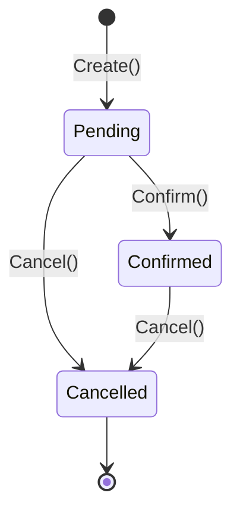

## Câu 1a

1. **Đóng gói (Encapsulation):** Gói dữ liệu và hành vi vào trong lớp, ẩn các thuộc tính bằng `private set` để bên ngoài không sửa tùy tiện, chỉ thao tác qua phương thức hợp lệ.
   - Minh hoạ: `EduHub.Domain/Entities/Member.cs` — lớp `Member`.

2. **Trừu tượng (Abstraction):** Ẩn chi tiết xử lý bên trong, chỉ đưa ra giao diện (`interface`) mô tả những hành vi cần thiết cho bên ngoài gọi.
   - Minh hoạ: `EduHub.Domain/Interfaces/IEventRepository.cs` — interface `IEventRepository`.

3. **Kế thừa (Inheritance):** Lớp con thừa hưởng thuộc tính và phương thức từ lớp cha để tái sử dụng và mở rộng code.
   - Minh hoạ: `EduHub.API/Controllers/EventsController.cs` — lớp `EventsController` (kế thừa `ControllerBase`).

4. **Đa hình (Polymorphism):** Cùng một lời gọi phương thức từ giao diện chung nhưng các lớp con khác nhau sẽ thực hiện theo cách riêng.
   - Minh hoạ: `EduHub.Infrastructure/Notifications/EmailNotificationService.cs` (`EmailNotificationService`) và `SmsNotificationService.cs` (`SmsNotificationService`).

## Câu 1b

Hai vấn đề của lớp `Member` chưa đóng gói:
1. Các thuộc tính `Id` và `Email` để `public { get; set; }` nên bên ngoài có thể gán hoặc sửa trực tiếp dữ liệu sai quy tắc (như `m.Email = "abc"`).
2. Constructor `public Member() { }` cho phép khởi tạo đối tượng rỗng không hợp lệ từ bên ngoài (`Id` bị `Guid.Empty`, `Email` chưa có giá trị) mà không qua bước kiểm tra.

## Câu 2a

## Câu 3a
Ba nguyên lý SOLID mà lớp `EventService` vi phạm:
1. **S — Single Responsibility Principle: mỗi class làm một việc**
   - **Dòng vi phạm:** Dòng 6–14 (dòng 6–7 kiểm tra đầu vào; dòng 8–9 thao tác DB; dòng 10 ghi log ra file; dòng 11–14 gửi thông báo).
   - **Giải thích:** Lớp `EventService` đảm nhiệm quá nhiều việc khác nhau (validate, truy cập CSDL, ghi file log, gửi thông báo), dẫn đến khi một trong các phần này thay đổi đều phải sửa lại lớp.
2. **O — Open/Closed Principle: thêm mới không sửa cũ**
   - **Dòng vi phạm:** Dòng 11–14 (`if (channel == "email") ... else if (channel == "sms") ...`).
   - **Giải thích:** Khi cần bổ sung kênh thông báo mới (ví dụ Slack, Push), phải sửa trực tiếp câu lệnh `if/else if` trong `EventService` thay vì chỉ thêm lớp mới.
3. **D — Dependency Inversion Principle: dựa vào interface**
   - **Dòng vi phạm:** Dòng 8 (`new SqlConnection(...)`), dòng 12 (`new EmailSender()`), dòng 14 (`new SmsSender()`).
   - **Giải thích:** Lớp nghiệp vụ cấp cao `EventService` đang tự `new` và phụ thuộc trực tiếp vào các lớp cụ thể cấp thấp thay vì phụ thuộc vào `interface` (như `IEventRepository`, `INotificationService`) qua Dependency Injection.