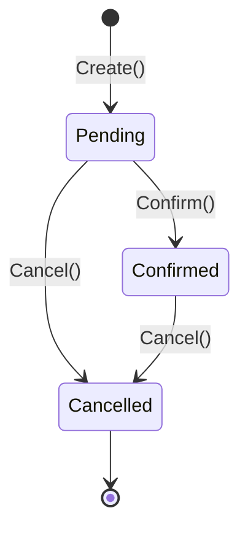
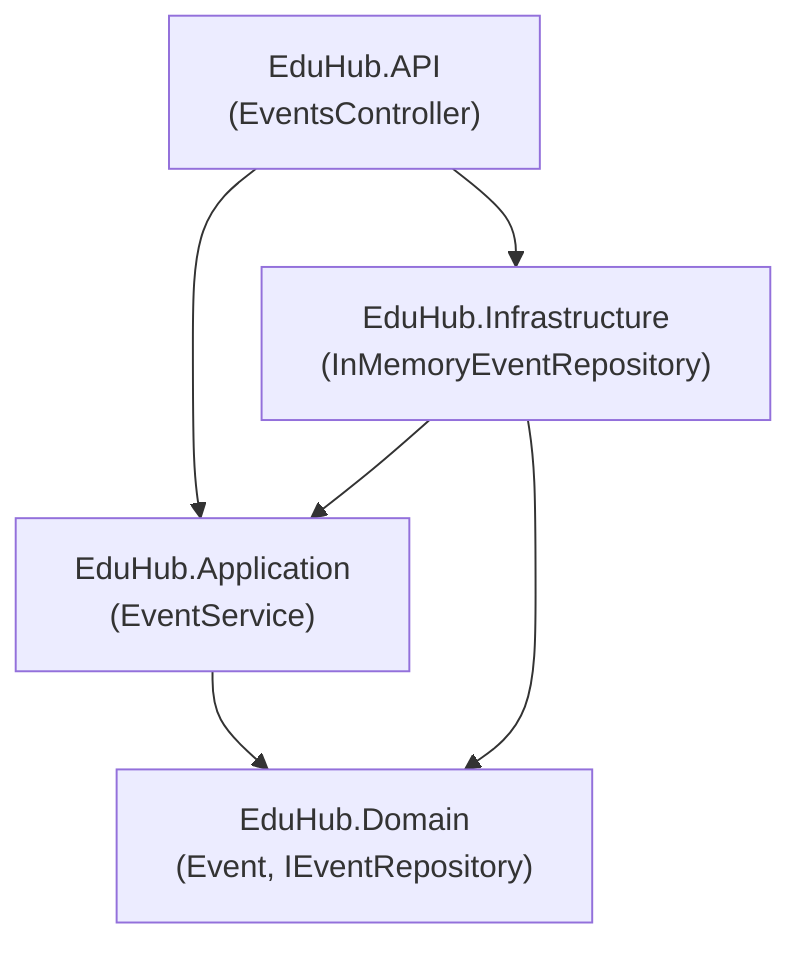

## Câu 1a

1. **Đóng gói (Encapsulation):** Gói dữ liệu và hành vi vào trong lớp, ẩn các thuộc tính bằng `private set` để bên ngoài không sửa tùy tiện, chỉ thao tác qua phương thức hợp lệ.
   - Minh hoạ: `EduHub.Domain/Entities/Member.cs` — lớp `Member`.

2. **Trừu tượng (Abstraction):** Ẩn chi tiết xử lý bên trong, chỉ đưa ra giao diện (`interface`) mô tả những hành vi cần thiết cho bên ngoài gọi.
   - Minh hoạ: `EduHub.Domain/Interfaces/IEventRepository.cs` — interface `IEventRepository`.

3. **Kế thừa (Inheritance):** Lớp con thừa hưởng thuộc tính và phương thức từ lớp cha để tái sử dụng và mở rộng code.
   - Minh hoạ: `EduHub.API/Controllers/EventsController.cs` — lớp `EventsController` (kế thừa `ControllerBase`).

4. **Đa hình (Polymorphism):** Cùng một lời gọi phương thức từ giao diện chung nhưng các lớp con khác nhau sẽ thực hiện theo cách riêng.
   - Minh hoạ: `EduHub.Infrastructure/Notifications/EmailNotificationService.cs` (`EmailNotificationService`) và `SmsNotificationService.cs` (`SmsNotificationService`).

## Câu 1b

Hai vấn đề của lớp `Member` chưa đóng gói:
1. Các thuộc tính `Id` và `Email` để `public { get; set; }` nên bên ngoài có thể gán hoặc sửa trực tiếp dữ liệu sai quy tắc (như `m.Email = "abc"`).
2. Constructor `public Member() { }` cho phép khởi tạo đối tượng rỗng không hợp lệ từ bên ngoài (`Id` bị `Guid.Empty`, `Email` chưa có giá trị) mà không qua bước kiểm tra.


## Câu 2a



## Câu 3a
Ba nguyên lý SOLID mà lớp `EventService` vi phạm:
1. **S — Single Responsibility Principle: mỗi class làm một việc**
   - **Dòng vi phạm:** Dòng 6–14 (dòng 6–7 kiểm tra đầu vào; dòng 8–9 thao tác DB; dòng 10 ghi log ra file; dòng 11–14 gửi thông báo).
   - **Giải thích:** Lớp `EventService` đảm nhiệm quá nhiều việc khác nhau (validate, truy cập CSDL, ghi file log, gửi thông báo), dẫn đến khi một trong các phần này thay đổi đều phải sửa lại lớp.
2. **O — Open/Closed Principle: thêm mới không sửa cũ**
   - **Dòng vi phạm:** Dòng 11–14 (`if (channel == "email") ... else if (channel == "sms") ...`).
   - **Giải thích:** Khi cần bổ sung kênh thông báo mới (ví dụ Slack, Push), phải sửa trực tiếp câu lệnh `if/else if` trong `EventService` thay vì chỉ thêm lớp mới.
3. **D — Dependency Inversion Principle: dựa vào interface**
   - **Dòng vi phạm:** Dòng 8 (`new SqlConnection(...)`), dòng 12 (`new EmailSender()`), dòng 14 (`new SmsSender()`).
   - **Giải thích:** Lớp nghiệp vụ cấp cao `EventService` đang tự `new` và phụ thuộc trực tiếp vào các lớp cụ thể cấp thấp thay vì phụ thuộc vào `interface` (như `IEventRepository`, `INotificationService`) qua Dependency Injection.


## Câu 4b

**Phân biệt `git merge` và `git rebase`:**
- **`git merge`:** Gộp hai nhánh bằng cách tạo thêm một **merge commit** mới (có 2 commit cha), **giữ nguyên** lịch sử phân nhánh và mã hash của các commit cũ.
- **`git rebase`:** Chuyển các commit của nhánh hiện tại đặt nối tiếp lên đầu nhánh đích, tạo ra các **commit mới với hash mới**, giúp lịch sử commit **thẳng hàng (linear)**, không có merge commit.

**Khi nào không nên dùng `rebase`:**
- **Không dùng trên nhánh công khai / nhánh dùng chung đã `push` lên remote** (như `main`, `develop`, hoặc nhánh có người khác đang làm cùng), vì `rebase` viết lại lịch sử (đổi hash commit), buộc phải `push --force` và dễ gây xung đột hoặc mất code của đồng đội.


## Câu 5a

Sơ đồ 4 lớp Clean Architecture và chiều phụ thuộc (mũi tên `A --> B` nghĩa là `A` tham chiếu tới `B`, mọi phụ thuộc đều hướng vào lõi `Domain`):



Vị trí các lớp theo từng project:
- **`EduHub.Domain`:** `Event`, `IEventRepository` *(không tham chiếu project nào)*
- **`EduHub.Application`:** `EventService` *(tham chiếu `EduHub.Domain`)*
- **`EduHub.Infrastructure`:** `InMemoryEventRepository` *(tham chiếu `EduHub.Domain`, `EduHub.Application`)*
- **`EduHub.API`:** `EventsController` *(tham chiếu `EduHub.Application`, `EduHub.Infrastructure`)*

## Câu 5b

Project `EduHub.Domain` không được tham chiếu tới `EduHub.Infrastructure` vì:
1. **Vi phạm Quy tắc phụ thuộc (Dependency Rule) và nguyên lý DIP:** `Domain` là tầng lõi chứa quy tắc nghiệp vụ thuần túy, còn `Infrastructure` chứa chi tiết kỹ thuật hạ tầng (CSDL, in-memory, Email/SMS, thư viện ngoài). Tầng ngoài phải phụ thuộc vào tầng trong qua `interface`, không được ngược lại.
2. **Gây phụ thuộc vòng (Circular Dependency):** `EduHub.Infrastructure` vốn đã tham chiếu `EduHub.Domain` để cài đặt `IEventRepository`; nếu `Domain` tham chiếu ngược lại sẽ lỗi vòng lặp và không biên dịch được.
3. **Khó thay đổi và khó kiểm thử:** Nếu nghiệp vụ bị gắn chặt vào công nghệ lưu trữ cụ thể, khi đổi từ `InMemory` sang `SQL Server / EF Core` sẽ phải sửa cả tầng lõi và không thể viết unit test độc lập cho `Domain`.


## Câu 5d

**Nguyên nhân:**
- Vòng đời **`AddScoped`** tạo ra **một instance `InMemoryEventRepository` mới cho mỗi HTTP request** và hủy nó ngay khi request kết thúc.
- Vì danh sách `List<Event> _events` là biến thể hiện thông thường (không `static`), dữ liệu được thêm vào trong request `POST` sẽ mất ngay sau khi request đó xong. Đến request `GET` kế tiếp, DI container lại tạo một instance `InMemoryEventRepository` hoàn toàn mới với `_events` rỗng, nên kết quả trả về là danh sách rỗng `[]`.

**Cách đã đăng ký để tránh lỗi:**
- Trong `EduHub.API/Program.cs`, em đăng ký `InMemoryEventRepository` bằng **`AddSingleton`**:
  ```csharp
  builder.Services.AddSingleton<IEventRepository, InMemoryEventRepository>();
  ```
- Với `AddSingleton`, toàn bộ ứng dụng chỉ dùng chung **duy nhất một instance** `InMemoryEventRepository` trong suốt thời gian chạy, nên dữ liệu tạo từ `POST` vẫn được giữ nguyên cho các request `GET` / `DELETE` sau đó.


